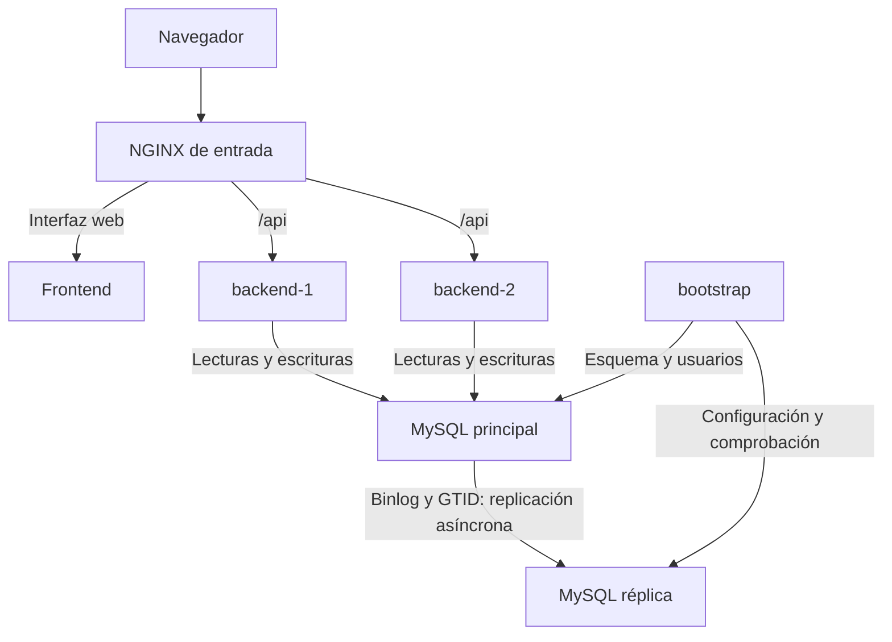

# Manual técnico

## 1. Objetivo

El sistema permite crear, consultar, buscar, actualizar y eliminar
pedidos mediante una aplicación web. Implementa dos instancias de
backend, balanceo de solicitudes y replicación asíncrona de MySQL.

## 2. Arquitectura distribuida

| Componente            | Responsabilidad                                  |
| --------------------- | ------------------------------------------------ |
| Frontend React        | Interfaz de gestión de pedidos                   |
| NGINX de entrada      | Entrega de la interfaz y balanceo de solicitudes |
| backend-1 y backend-2 | Instancias equivalentes de la API FastAPI        |
| MySQL principal       | Lecturas y escrituras de la aplicación           |
| MySQL réplica         | Copia asíncrona de las tablas de pedidos         |
| bootstrap             | Preparación del esquema, usuarios y replicación  |

Los contenedores se comunican mediante la red interna de Docker Compose.
La entrada web se publica en http://localhost:8080.

Todos los contenedores funcionan en un mismo equipo. Se simula una
arquitectura distribuida entre procesos; no se tolera la caída del
equipo anfitrión.

## 3. Diagrama de componentes y flujo de datos



El navegador solicita la interfaz a NGINX. Las operaciones de pedidos
se envían a la API y el balanceador selecciona un backend disponible.
El backend realiza la operación sobre MySQL principal y devuelve
la respuesta. La réplica aplica posteriormente las transacciones.

La API no consulta la réplica para atender pedidos.

## 4. Tolerancia a fallos y consistencia

### Redundancia del backend

Las dos instancias ejecutan la misma API y comparten la persistencia.
Si una deja de responder, NGINX puede enviar solicitudes a la otra.

NGINX detecta fallos de forma pasiva. Los healthchecks de Docker
informan del estado de los servicios, pero NGINX no los consulta
activamente.

Una solicitud en curso durante una caída puede fallar. No se garantiza
que todas las operaciones se reintenten automáticamente.

### Replicación

MySQL utiliza binlog y GTID para replicar las tablas pedidos.%.
La replicación es asíncrona: confirmar una escritura en el principal
no garantiza que ya esté aplicada en la réplica.

No se implementa promoción automática de la réplica. Si cae el
principal, la gestión de pedidos queda interrumpida hasta recuperarlo.

### Reintentos y edición concurrente

La creación utiliza Idempotency-Key para evitar duplicar pedidos
cuando se repite una solicitud con la misma clave y contenido.

Las actualizaciones comprueban la versión del pedido. Una modificación
basada en una versión anterior se rechaza con HTTP 409.

Los detalles del modelo y de las transacciones se encuentran en
[Arquitectura y decisiones](arquitectura.md).

## 5. Ejemplo de fallo simulado

Con el sistema operativo, ejecutar:

```powershell
docker compose stop backend-1
```

Crear y consultar un pedido desde la interfaz.

Resultado esperado: backend-2 atiende las nuevas operaciones.
Registrar el resultado observado y una captura como evidencia.

Recuperar el servicio:

```powershell
docker compose start backend-1
```

Esperar su recuperación y comprobar que ambos nodos vuelven a atender
solicitudes.

La demostración automatizada se ejecuta desde la raíz del proyecto:

```powershell
python scripts/probar_fallos.py
```

El script prueba la caída de cada backend y su reincorporación.
Consultar [Guía de fallos](pruebas_fallos.md).

Este manual describe resultados esperados; no certifica que las
pruebas hayan sido ejecutadas.

## 6. Tecnologías y justificación

| Tecnología           | Justificación                                       |
| -------------------- | --------------------------------------------------- |
| React                | Organización de la interfaz mediante componentes    |
| FastAPI              | API REST, validación y documentación de endpoints   |
| Pydantic             | Validación de datos de entrada y configuración      |
| SQLAlchemy y PyMySQL | Acceso a MySQL y manejo de transacciones            |
| MySQL 8.4            | Persistencia relacional y replicación mediante GTID |
| NGINX                | Punto de entrada HTTP y balanceo entre backends     |
| Docker Compose       | Ejecución reproducible de servicios y red interna   |
| pytest y HTTPX       | Automatización de pruebas de la API                 |

## 7. Límites

- NGINX es un punto único de fallo.
- MySQL principal es un punto único de fallo para gestionar pedidos.
- La réplica puede acumular retraso.
- La caída del equipo detiene todos los servicios.
- La demostración local no incluye autenticación ni HTTPS.
- La réplica no sustituye una estrategia de copias de seguridad.
